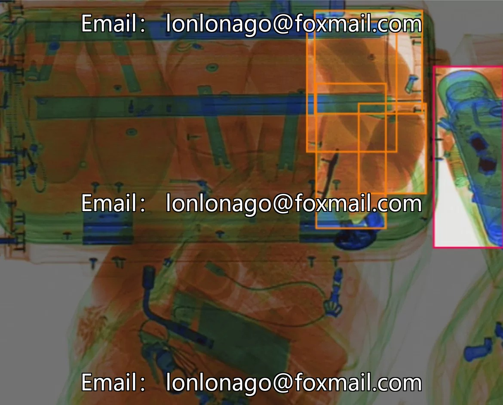
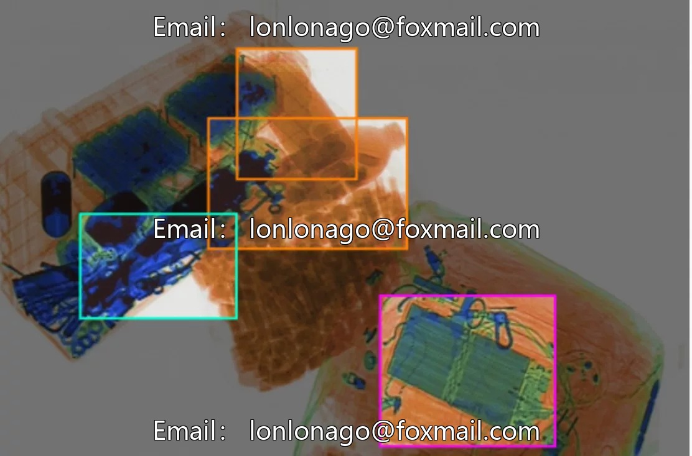
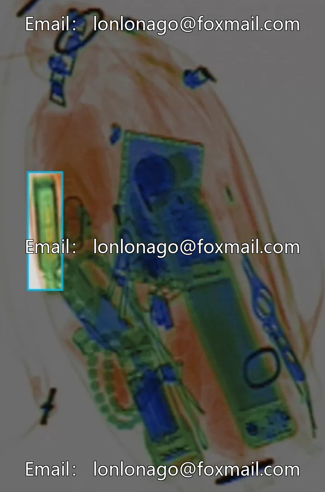
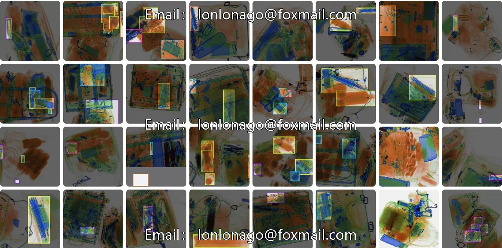
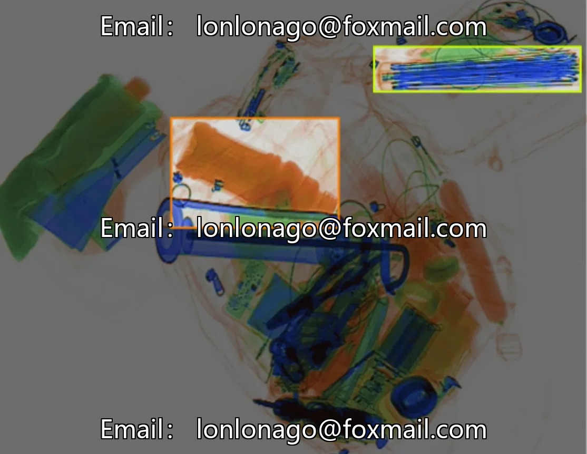
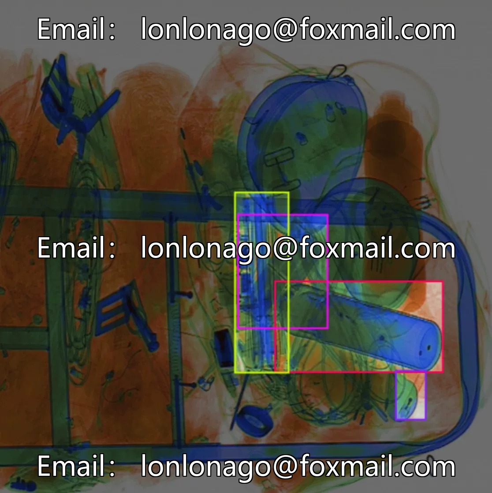
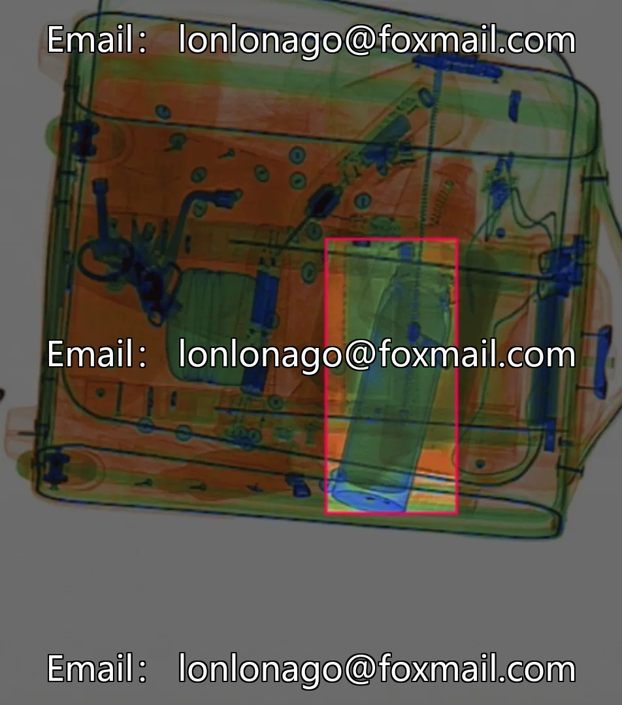

# Intelligent security and safety recognition dataset, subway security inspection X-ray image target detection dataset, 1st

## Body

Intelligent Security and CCTV Image Target Detection Dataset for Subway Security, Issue 10213
Contains 5678 images, categorized into 8 categories: drinkbottle, glassbottle, knife, lighter, metalcup, powerbank, umbrella, wrench.
The data is in image file format, supporting upload to test model effectiveness. Suitable for target detection technology research, training and optimization of models for hazard identification, charging banks, umbrellas, forks, etc.

Virtual materials, once sold, are non-refundable.
Interested friends, click "I want" to proceed.

## Images

## Payment

Here is a pay link on Stripe ( https://buy.stripe.com/3cs8yP7sY87d0vu9AB ). Please contact me lonlonago@foxmail.com after funding $89, and I will send you a complete data files , thank you!

